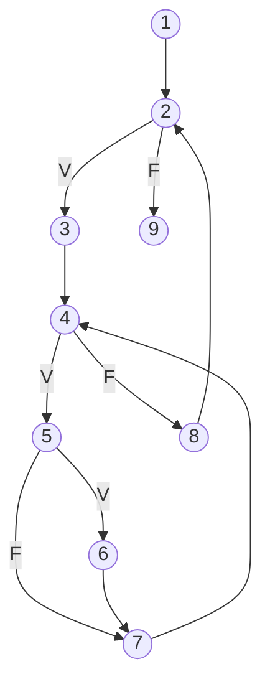

# Laboratorio 4: xUnit y Cobertura de Código

**Universidad Nacional de San Agustín de Arequipa**
Escuela Profesional de Ciencia de la Computación: Ingeniería de Software II

**Autor:** Huaylla Guzman Roid Niro | **CUI:** 20240835 | **Grupo:** A

## Descripción

Pruebas de caja blanca del algoritmo **bubbleSort**: grafo de flujo de control, complejidad ciclomática, caminos independientes y casos de prueba automatizados con **unittest** (xUnit) y medición de cobertura con **Coverage.py**.

| Elemento | Herramienta |
|---|---|
| Lenguaje | Python 3 (orientado a objetos) |
| Framework xUnit | `unittest` |
| Cobertura | Coverage.py 7.16.2 |

## Estructura del proyecto

```
lab04_bubblesort/
├── src/
│   ├── __init__.py
│   └── ordenador.py          # Clase Ordenador con bubble_sort
├── tests/
│   ├── __init__.py
│   └── test_ordenador.py     # Casos de prueba CP1 a CP4
├── .coveragerc               # Configuración de cobertura (ramas)
├── .gitignore
├── requirements.txt
└── README.md
```

## Código analizado

```c
bubbleSort(int vet[]){
  integer i, j, aux;
  for (i = tamanho(vet); i >= 2; i--){
    for (j = 1; j <= i-1; j++){
      if (vet[j] > vet[j+1]){
        aux = vet[j];
        vet[j] = vet[j+1];
        vet[j+1] = aux;
      }
    }
  }
}
```

## Grafo de flujo de control

| Nodo | Sentencia |
|---|---|
| 1 | `i = tamanho(vet)` |
| 2 | `i >= 2` (predicado) |
| 3 | `j = 1` |
| 4 | `j <= i-1` (predicado) |
| 5 | `vet[j] > vet[j+1]` (predicado) |
| 6 | `aux = vet[j]; vet[j] = vet[j+1]; vet[j+1] = aux` |
| 7 | `j++` |
| 8 | `i--` |
| 9 | Fin |



## Complejidad ciclomática

- Nodos: N = 9, aristas: E = 11, nodos predicado: P = 3
- V(G) = E − N + 2 = 11 − 9 + 2 = **4**
- V(G) = P + 1 = 3 + 1 = **4**

Se requieren **4 caminos independientes** y, como mínimo, **4 casos de prueba**.

## Caminos independientes

Estrategia: cobertura de decisiones + condición simple (cada predicado tiene una sola condición, por lo que coincide con condición múltiple).

1. `1-2-9`
2. `1-2-3-4-5-7-4-8-2-9`
3. `1-2-3-4-5-6-7-4-8-2-9`
4. `1-2-3-4-5-6-7-4-5-6-7-4-8-2-3-4-5-7-4-8-2-9`

## Casos de prueba

| ID CP | Camino en el Grafo | Valores de Prueba | Resultado Esperado |
|---|---|---|---|
| CP1 | 1-2-9 | `[7]` | `[7]` |
| CP2 | 1-2-3-4-5-7-4-8-2-9 | `[1, 2]` | `[1, 2]` |
| CP3 | 1-2-3-4-5-6-7-4-8-2-9 | `[2, 1]` | `[1, 2]` |
| CP4 | 1-2-3-4-5-6-7-4-5-6-7-4-8-2-3-4-5-7-4-8-2-9 | `[3, 1, 2]` | `[1, 2, 3]` |

## Cómo ejecutar

```powershell
# 1. Crear y activar el entorno virtual
python -m venv venv
venv\Scripts\activate

# 2. Instalar dependencias
pip install -r requirements.txt

# 3. Ejecutar las pruebas
python -m unittest discover -s tests -t . -v

# 4. Generar la cobertura
coverage run -m unittest discover -s tests -t .
coverage report -m
coverage html
start htmlcov\index.html
```

## Resultados

- **Pruebas:** 4 ejecutadas, 4 aprobadas (`OK`).
- **Cobertura:** 100 % de sentencias (10/10) y 100 % de ramas (6/6) en `src/ordenador.py`.

## Ciclo TDD aplicado

1. **Rojo:** pruebas contra `bubble_sort` sin implementar (`NotImplementedError`): las 4 pruebas dan `ERROR`.
2. **Verde:** implementación mínima de `bubble_sort`: las 4 pruebas pasan.
3. **Refactorizar:** documentación y claridad sin cambiar el comportamiento.